<div align="center">

# ArcherLab Edge

### Privacy-first computer vision and performance analytics for precision archery

**[Live demo](https://archerlab-edge.vercel.app)** · **[Try the sample session](https://archerlab-edge.vercel.app)** · **[User guide](https://archerlab-edge.vercel.app/guide)** · **[Privacy](https://archerlab-edge.vercel.app/privacy)** · **[Changelog](CHANGELOG.md)**


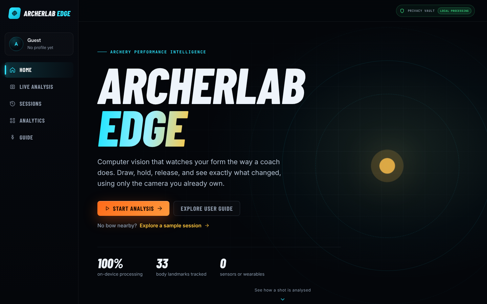

</div>

---

## From an athlete's problem to an engineering solution

ArcherLab Edge began with a question from my own experience as an archer:

> **Can technology help an athlete better understand the small details that influence performance consistency?**

Precision sports are decided by details that are hard to see: movement stability, body alignment, repeatability between attempts, and how technique relates to results. Analysing them usually takes expensive sensors, specialised equipment or hours of manual video review.

As both an athlete and a computer science student, I wanted to find out whether a standard laptop or phone camera, combined with modern computer vision, could make that analysis accessible, **while keeping every frame of the athlete's video on their own device.**

That became ArcherLab Edge: a system at the intersection of precision athletics, computer vision, biomechanics, statistics and privacy-preserving computing.

---

## Try it in ten seconds

No bow, no camera, no account needed.

1. Open **[archerlab-edge.vercel.app](https://archerlab-edge.vercel.app)**.
2. Click **Explore a sample session** under the main buttons.
3. Browse a 12-arrow round in **Analytics**, then click any arrow to open its **Replay**.

The sample session is not hard-coded data. Synthetic pose frames are run through the app's real `ShotCaptureEngine`, so every metric you see is genuine engine output.

To analyse yourself, click **Start Analysis**, allow camera access and stand side-on to the camera. Or click **Analyse a Video** and upload a clip you have already filmed, from any angle: preview it, trim it to the shots you want reviewed, and press **Analyse**.

---

## One shot, four moments

The landing page walks through a single shot as you scroll: the draw, the hold, the release and the impact. Each step explains what ArcherLab Edge measures at that moment.

<div align="center">
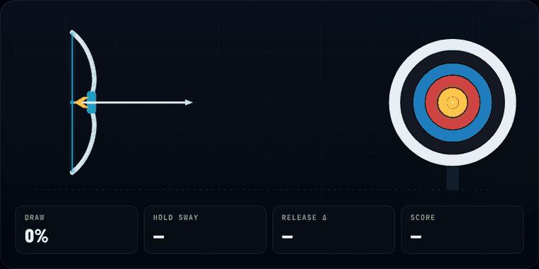
</div>

---

## Screenshots

### Live Analysis

Pose landmarks are tracked live on the device. A broadcast-style status bar shows session time, shots and tracking state, and the biomechanics panel updates shoulder line, bow-arm angle, torso lean, head motion and bow-hand motion in real time.

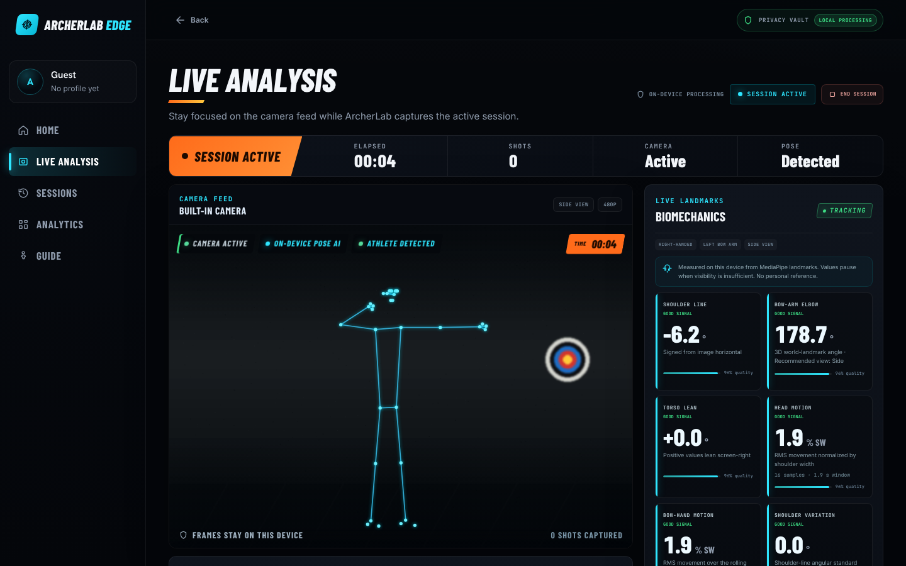

<sub>Screenshot taken with a simulated camera feed and synthetic pose data; in real use the feed is your own camera.</sub>

### Video Analysis

Upload a recorded clip, trim it to the part you want, and the second engine tracks every frame, listens for the sound of each release, and splits the clip into shots and phases. It returns a form score and an estimated level (both labelled as unvalidated estimates from movement only), the top things to work on (each with a drill and a **Show me** button that jumps the replay to the moment) and a practice plan. It works from side-on, angled and down-the-line footage.

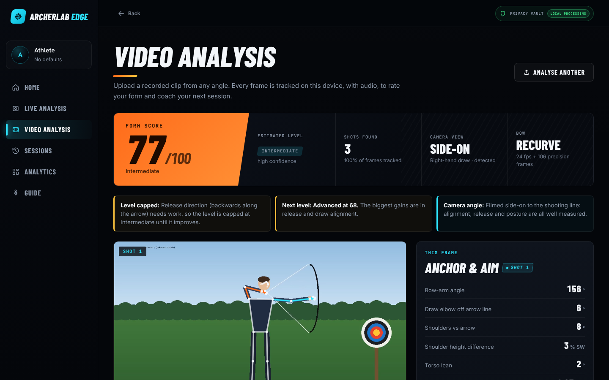

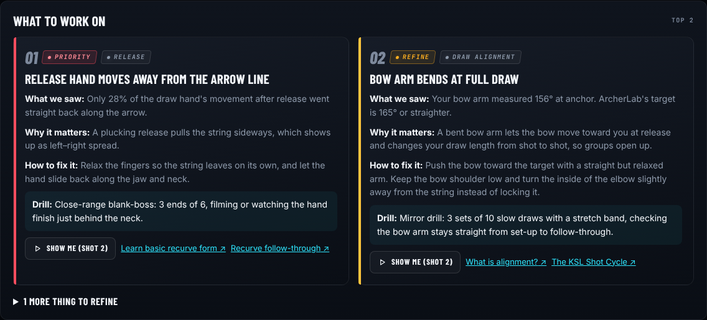

<sub>Screenshots from a rendered synthetic test clip with a simulated pose model, used to test the pipeline end to end; real clips use the on-device MediaPipe model.</sub>

### Performance Analytics

A scoreboard summary, a scorecard split into ends of six, where every arrow landed on the target, and arrow-by-arrow form charts coloured by score. These make it easy to see whether shaky holds line up with lower scores.

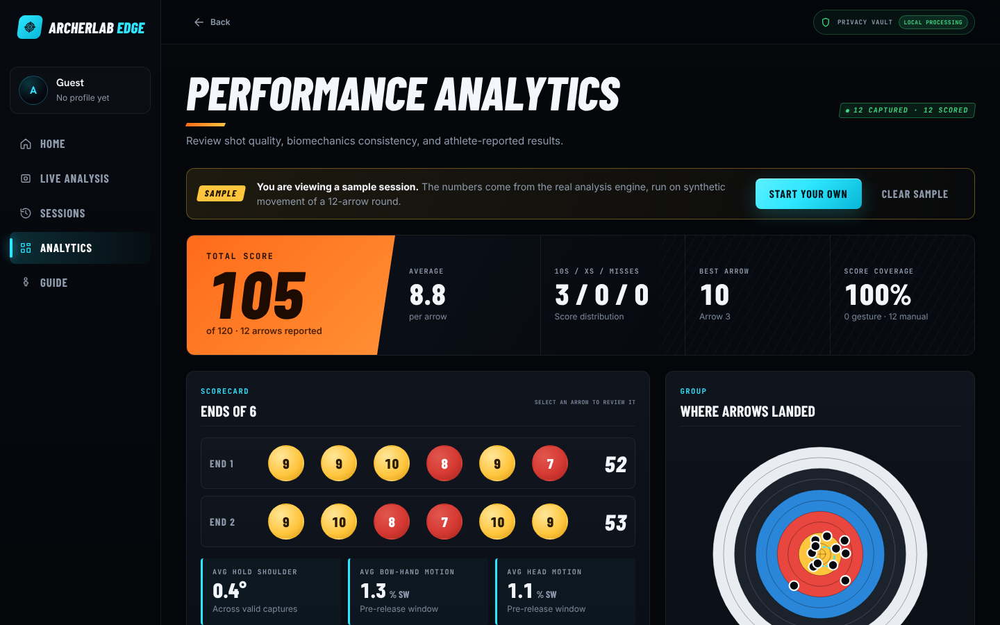

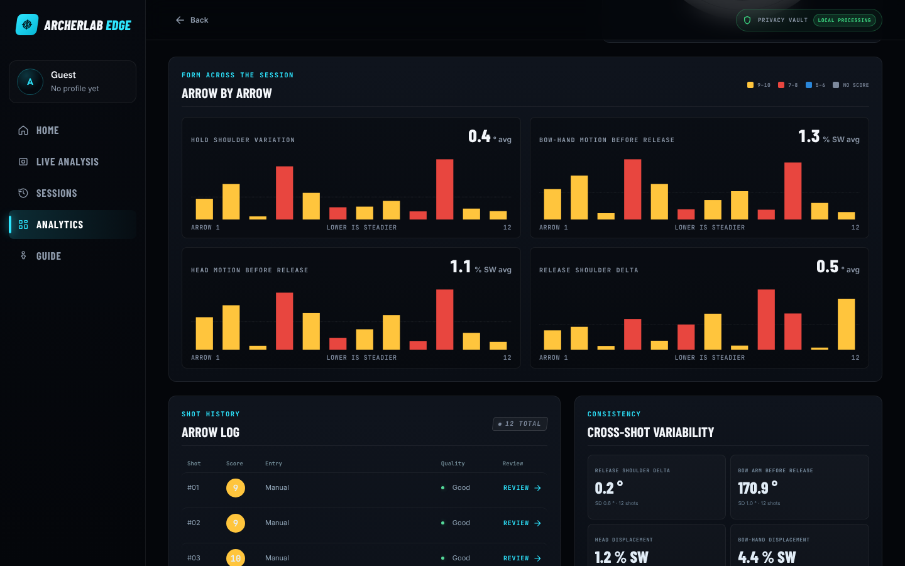

### Shot Replay

Every captured arrow can be reviewed on its own: the athlete-reported score, data-quality indicators, and each metric charted across hold, release and follow-through. Previous and next buttons step through the round.

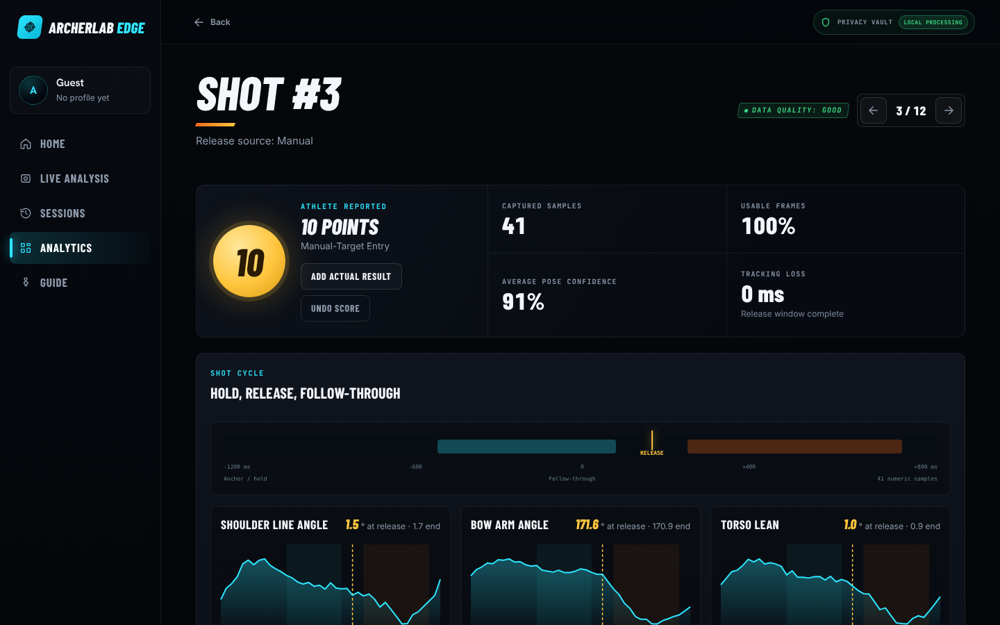

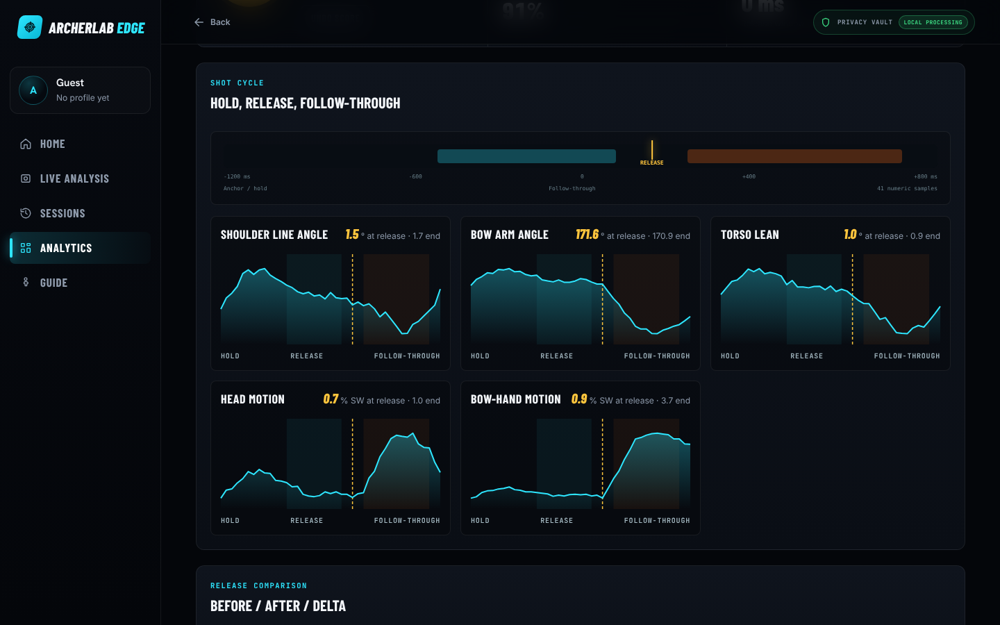

### Sessions and guided setup

<table>
  <tr>
    <td width="50%">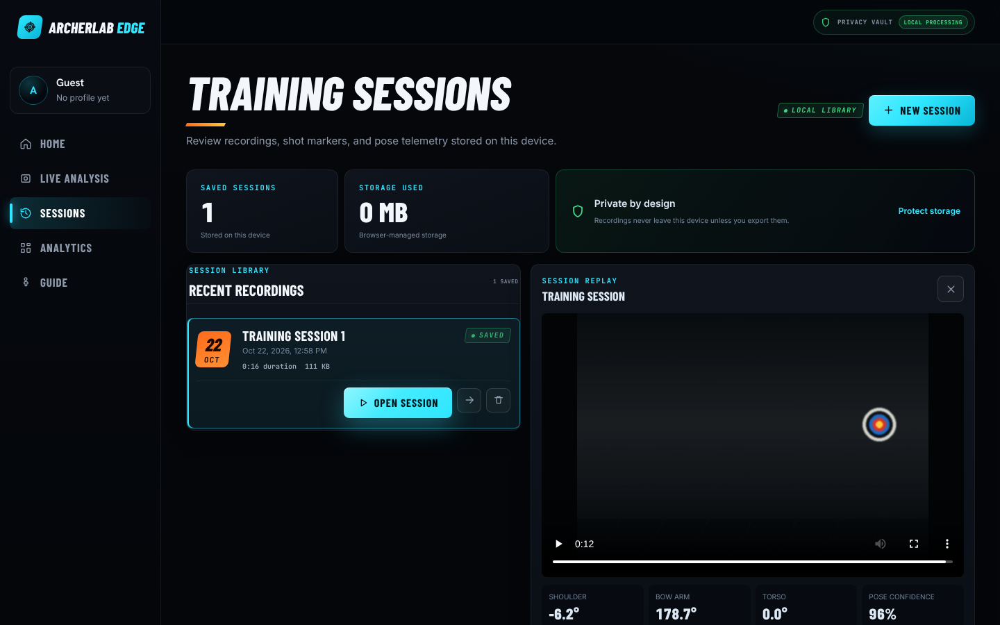</td>
    <td width="50%">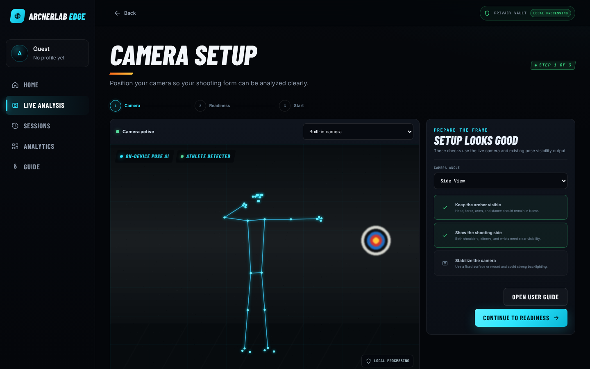</td>
  </tr>
  <tr>
    <td><b>Sessions.</b> Recordings are saved in the browser and replayed with synchronised telemetry and shot markers.</td>
    <td><b>Guided setup.</b> Camera framing, readiness checks and session start, before anything is recorded.</td>
  </tr>
  <tr>
    <td width="50%">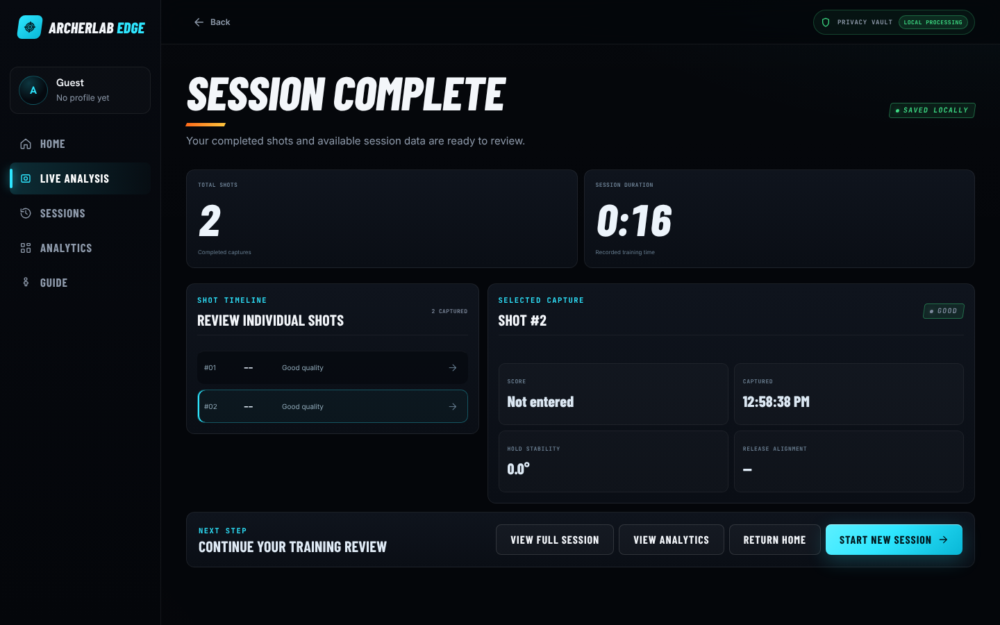</td>
    <td width="50%">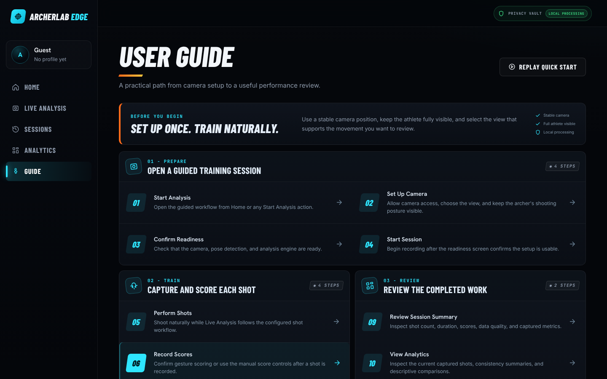</td>
  </tr>
  <tr>
    <td><b>Session summary.</b> Shots captured, duration and per-shot review straight after training.</td>
    <td><b>User guide.</b> A ten-step manual from camera setup to analytics, with deep links for each step.</td>
  </tr>
</table>

### Mobile

The whole workflow works on a phone, with a raised **Live** button in the bottom navigation.

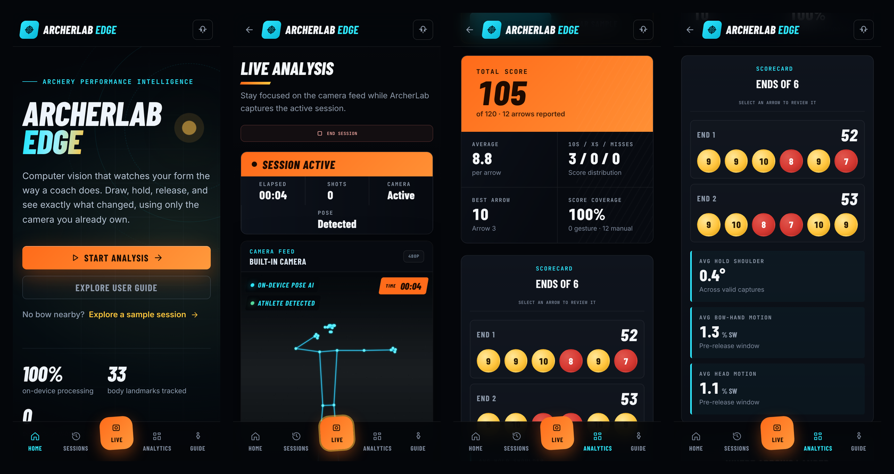

---

## What ArcherLab Edge does

### 1. On-device computer vision
MediaPipe Tasks Vision runs in the browser through WebAssembly: Pose Landmarker for the athlete's body, Hand Landmarker for gesture scoring. It includes athlete detection, skeleton visualisation, confidence-based quality handling and temporal smoothing. There is no cloud video inference.

### 2. Biomechanics engine
Landmarks are converted into archery-specific measurements: shoulder alignment, bow-arm geometry, torso position, head stability, bow-hand movement and variation over time. The engine is separate from the interface, so the calculations and the visuals can evolve independently.

### 3. Shot-cycle analysis
Archery is a sequence, not a single frame. Each shot is buffered and split into draw, hold, release and follow-through, with pre- and post-release windows, release metrics, data-quality summaries and follow-through analysis. Automatic release detection is available as an experimental option.

### 4. Touchless scoring
Archers can show their score with a hand gesture after each arrow, so they don't need to touch a device between shots. Stability confirmation guards against misreads, and manual and on-target entry are available as fallbacks. Or they can say it: a **voice note** ("nine, dropped the bow arm") is transcribed by Whisper on the device, the score is offered for confirmation, and the words are saved as the shot's notes. The audio never leaves the device ([docs/voice-notes.md](docs/voice-notes.md)).

### 5. Recording and replay
Sessions are recorded locally with synchronised pose telemetry and shot markers, then replayed from the Sessions library. Recorded data is kept separate from analytical data, so the analysis can improve without re-recording sessions.

### 6. Performance analytics
Totals, averages, a scorecard by end, target grouping, consistency statistics across shots, and a comparison of form between high- and low-scoring arrows. This comparison is presented as a descriptive association only; the app does not claim causation.

### 7. Experimental modelling
An exploratory layer simulates shot distributions and visualises uncertainty from observed groups. It is clearly labelled as experimental and is not presented as an arrow-impact predictor.

### 8. Video analysis: a second engine
A separate engine for recorded clips (`src/video-analysis`). Because it sees the whole clip, it smooths without lag, finds every shot automatically (release first, then anchor, draw and follow-through, rejecting let-downs), and snaps each release to its sound for millisecond timing; it also picks up clicker and arrow-impact sounds. 3D world landmarks make the measurements largely independent of camera angle, and the view is detected automatically. A transparent rubric scores six areas and estimates a level (with caps when a fundamental fault remains). Both are labelled as unvalidated estimates, and the result can be written to the athlete profile so progress is tracked over time. Details: [docs/video-analysis.md](docs/video-analysis.md).

- **Trim before analysis.** A chosen video is previewed first; the 15-minute limit applies to the selected part, not the file, so a long session recording can be analysed a stretch at a time. The screen is kept awake while it runs.
- **Larger pose models.** Lite ships with the app; Full and Heavy are downloaded automatically on Vercel builds, and Full is preselected when available.
- **Video shots in Analytics.** **Open in Analytics** runs a clip through the live capture engine, so its shots appear in Analytics and Replay, ready for scores.
- **Re-score and reopen.** Change the bow type or drawing hand and re-score from the stored movement without re-tracking. Export a report as JSON and open it later; it is scored again with the current engine.
- **3D view.** A tab next to the replay draws the tracked skeleton in 3D (world landmarks, metres), to orbit around the archer at any frame.
- **Anchor on the face** (experimental). Face and hand models look at a few frames of each anchor, on a crop around the head, to measure where the index fingertip sits against the chin and mouth corner, and how much that changes between shots; a face diagram shows one dot per shot ([details](docs/video-analysis.md#anchor-on-the-face-experimental)).
- **Convert to MP4 on this device.** A clip the browser cannot play, such as an iPhone HEVC `.mov` in Chrome, can be converted to H.264 with ffmpeg running in the browser; the converter downloads only when asked for ([docs/video-conversion.md](docs/video-conversion.md)).
- **Coach tools** (off by default): label a clip shot by shot (release frame, false and missed shots, let-downs, 1–5 per area, a level) and export it as a fixture without the video; `npm run validate:fixtures` reports detection precision and recall, release timing error, Spearman correlation with the coach's ratings and level agreement ([docs/validation.md](docs/validation.md)).
- **Real-clip fixtures.** Exported reports with an expected shot count and release times become regression tests ([how](src/video-analysis/fixtures/README.md)).

### 9. Optional second opinions, backup and imports
From any video report, athletes can ask Claude, GPT and Gemini for a coaching review with **their own API keys** (six annotated stills plus the measurements, after an explicit consent tick; never the video unless they opt in). The coaches' views are combined to show where they agree. A **private coach** can instead run on the athlete's own device with WebLLM (one-time model download, asked first; nothing is sent anywhere) and answer follow-up questions about the report: see [docs/local-coach.md](docs/local-coach.md). Accounts and cloud backup (Supabase) and Dropbox / Google Drive import can be switched on by whoever deploys the app. With accounts on, a signed-in athlete can share a report read-only with a coach's email (the video only if they include it), and both can leave comments pinned to moments of the replay; shares can be revoked at any time. All of this is off by default: see [docs/cloud-setup.md](docs/cloud-setup.md).

### 10. Privacy controls
The [Privacy page](https://archerlab-edge.vercel.app/privacy) explains in plain language what runs and is stored on the device and what each optional feature sends, and to whom. It lets athletes export all their video reports, delete their video analyses or everything the app stores on the device, and, when signed in, delete their cloud data or their account.

---

## System architecture

```text
Camera input
     │
     ▼
Local MediaPipe processing (WebAssembly)
     │
     ├──────────────────┐
     ▼                  ▼
Pose analysis      Hand analysis
     │                  │
     ▼                  ▼
Biomechanics       Gesture scoring
     │                  │
     └────────┬─────────┘
              ▼
       Shot-cycle capture
              │
              ▼
   Session analytics & replay
              │
              ▼
     Experimental modelling
```

The video engine runs alongside it:

```text
Video file ─► preview & trim ─► audio onsets (in range) ─────┐
                    │                                      ▼
                    └─► pose on every frame ─► smoothed tracks ─► shots & phases ─► metrics ─► scores & level
                          (precision pass at each release) ──┘                          └─► coaching & plan
```

## Privacy-first by design

```text
Camera ─► Local vision models ─► Landmarks ─► Biomechanics ─► Local session data
                     (nothing leaves the device)
```

- Video frames are processed in the browser, for live sessions and uploaded clips alike.
- Profiles, recordings and video reports are stored on the device (IndexedDB).
- Fonts and models are self-hosted, so no visitor data is sent to third-party CDNs.
- Installable and offline-capable: after the first visit the app and its models are kept in the browser's cache, which never holds athlete data or cloud (Supabase, AI provider) requests ([docs/pwa.md](docs/pwa.md)).
- Voice notes are transcribed by Whisper in the browser; the audio is never uploaded or saved ([docs/voice-notes.md](docs/voice-notes.md)).
- No account needed and no analytics trackers.
- Optional and off by default: AI coach reviews (sent only to the provider the athlete picks, with their own key and explicit consent), and account backup and sharing a report with a coach when the deployment enables accounts.
- A [Privacy page](https://archerlab-edge.vercel.app/privacy) with export and delete controls for everything on the device, and for cloud data and the account when signed in.

---

## Technology stack

| Area | Tools |
| --- | --- |
| Frontend | React 19, TypeScript, Vite, `vite-plugin-pwa` (Workbox) |
| Computer vision | MediaPipe Tasks Vision (Pose, Hand and Face Landmarker), WebAssembly; three.js for the 3D view |
| Browser APIs | MediaDevices camera capture, MediaRecorder, requestVideoFrameCallback, Web Audio, Screen Wake Lock, IndexedDB, Service Worker and Cache Storage (offline, installable), Canvas and SVG |
| Optional cloud | Claude, OpenAI and Gemini APIs (bring your own key); Supabase Auth, Postgres and Storage over REST |
| On-device AI and media | Whisper (whisper-tiny) via Transformers.js for voice notes; WebLLM (WebGPU) running Qwen2.5-1.5B-Instruct (Apache-2.0) for the optional private coach; ffmpeg.wasm for converting video |
| Quality | Vitest + Testing Library (81 test files, 499 cases), Playwright end-to-end tests with axe accessibility checks, oxlint, GitHub Actions CI |
| Hosting | Vercel (production deploys from `main`; builds fetch the larger pose models), GitHub Codespaces for development |

## Repository structure

```text
src/
├── analytics        session datasets and statistics
├── biomechanics     landmark geometry, smoothing, archery metrics
├── cloud            optional AI coaches, accounts/backup (incl. cloud delete), coach review and storage import
├── components       shared UI (camera, overlays, metric cards, navigation, video report)
├── demo             sample session generated through the real capture engine
├── export           session JSON and CSV export
├── gesture-entry    hand-gesture score recognition
├── hooks            camera, pose, recording, shot-analysis and wake-lock hooks
├── landing          scroll-driven landing animation
├── local-coach      optional on-device AI coach (WebLLM model, review and follow-up chat)
├── navigation       page ↔ URL routes
├── pages            Live Analysis, Video Analysis, Analytics, Replay, Sessions, Guide, Profile, Privacy
├── privacy          export and delete everything stored on the device
├── profile          local athlete profile storage
├── pwa              service worker registration, update prompt state, online status
├── recording        local session recording and replay storage
├── services         MediaPipe landmarker services
├── shot-analysis    shot buffering, release capture, phases, summaries
├── simulation       experimental shot-distribution modelling
├── styles           theme and self-hosted fonts
├── target           target-face geometry and scoring
├── training         guided session workflow state machine
├── types            typed domain models
└── video-analysis   second engine: recorded clips, audio, scoring, coaching, ranges,
                     report files, conversion to live-engine shots
    ├── browser      frame capture, audio decoding, pose models (browser-only)
    ├── fixtures     real-clip regression fixtures (exported reports)
    └── testing      synthetic archer and range audio for the tests
docs/                engine notes, cloud setup, offline and install
e2e/                 Playwright end-to-end and accessibility tests (stubbed pose model, synthetic clip)
public/pwa/          app icons generated from favicon.svg
scripts/             pose model download (run automatically on Vercel builds), e2e clip and PWA icon generators
supabase/            SQL for optional accounts, backup, coach review and account deletion
```

---

## Documentation

| Document | Covers |
| --- | --- |
| [docs/video-analysis.md](docs/video-analysis.md) | The video engine: pipeline, segmentation, audio, scoring, trimming, larger pose models, limits |
| [docs/bow-detection.md](docs/bow-detection.md) | Building a bow, arrow and target-face dataset with the Dataset tools (Coach tools), how much to label, privacy, and licence-checked training options |
| [docs/validation.md](docs/validation.md) | Checking the scores against coaches: Coach tools labelling, fixture export, `npm run validate:fixtures`, consent and how to tune the rubric |
| [docs/voice-notes.md](docs/voice-notes.md) | On-device voice notes with Whisper: score parsing, the model and runtime, download and caching, languages |
| [docs/video-conversion.md](docs/video-conversion.md) | Converting a clip the browser cannot play to MP4 on the device: flow, ffmpeg settings, the self-hosted core, licence |
| [docs/cloud-setup.md](docs/cloud-setup.md) | Optional AI review, accounts and backup, remote coach review, account deletion, imports, environment variables |
| [docs/local-coach.md](docs/local-coach.md) | The on-device private coach: model, licence, download size, memory and how to update it |
| [docs/biomechanics.md](docs/biomechanics.md) | Live-engine measurement conventions (handedness, angle signs, normalisation) |
| [docs/pose-intelligence.md](docs/pose-intelligence.md) | On-device MediaPipe setup and self-hosted assets |
| [docs/pwa.md](docs/pwa.md) | Installing the app, what works offline and how it is cached, the update prompt, icons |
| [src/video-analysis/fixtures/README.md](src/video-analysis/fixtures/README.md) | Turning real clips into regression tests |
| [CHANGELOG.md](CHANGELOG.md) | What changed in each version |

## Running locally

```bash
npm ci
npm run dev        # start the dev server on http://localhost:5173
npm test           # run the test suite
npm run check      # lint + tests + production build
npm run test:e2e   # Playwright end-to-end and accessibility tests (first: npx playwright install chromium)
npm run models:pose  # optional: download the Full pose model (add `-- heavy` for Heavy)
npm run build && npm run preview   # production build with the service worker (none in `npm run dev`)
```

The end-to-end tests (`e2e/`) build the app with `VITE_E2E=1`, which swaps the MediaPipe pose model for a stub that returns a synthetic archer's landmarks, and upload `e2e/fixtures/synthetic-archer.webm`. That clip is generated from `src/video-analysis/testing/` by `npm run e2e:clip` (headless Chromium, no extra tools); regenerate and commit it after changing `e2e/support/scenario.ts`. Normal builds never include the stub.

Vercel builds run `npm run build:vercel`, which downloads the Full and Heavy pose models before building; locally they are optional, and the downloaded `.task` files are not committed.

Optional cloud features are configured with environment variables; copy `.env.example` to `.env.local` and see [docs/cloud-setup.md](docs/cloud-setup.md). Without them the app stays fully on-device.

Camera access needs a secure context: `localhost` during development, HTTPS in production.

### Cloud development with GitHub Codespaces

GitHub is the source of truth, and Vercel deploys production from `main`.

1. Open the [repository](https://github.com/sarwan-1313/archerlab-edge), click **Code → Codespaces → Create codespace on main**.
2. Wait for the dev container and the automatic `npm ci` to finish.
3. Run `npm run dev` and open the forwarded port **5173**.
4. Run `npm test` during development and `npm run check` before pushing.

Real webcam testing uses the browser or device that opens the app.

### Guide deep links

The manual uses browser-history routes such as `/guide/camera-setup` and `/guide/analytics`. Vite serves them automatically. In production, `vercel.json` rewrites unknown paths to `index.html`, so refreshing or opening a guide link directly still works.

---

## Engineering highlights

- **Domain-driven.** Built around a real problem from competitive archery, not as an isolated technology demo.
- **Movement over time.** Shots are analysed as sequences with phases, not as independent frames.
- **Separation of concerns.** Camera, biomechanics, shot analysis, recording, analytics and UI are independent modules.
- **Honest analytics.** Experimental features are labelled, and associations are never presented as causation.
- **Complete product workflow.** Guided setup, live analysis, scoring, recording, replay, analytics and profiles.
- **Accessible.** Keyboard focus styles, reduced-motion support, and text contrast that meets the WCAG AA standard.

---

## Current status

**v0.2.0: experimental engineering prototype**, now with a video analysis engine, privacy controls and optional cloud features ([changelog](CHANGELOG.md)). Current focus:

- validating the technical foundation;
- exploring browser-based sports intelligence;
- building toward athlete-centred research.

## Limitations

- Biomechanics outputs are not medically validated.
- Gesture scoring records what the athlete reports.
- Automatic release detection in the live engine is experimental.
- Video analysis scores and levels are estimates from coaching heuristics that have not yet been validated against coach ratings, and depth from a single camera is approximate.
- Video analysis covers up to 15 minutes at a time, and files longer than 30 minutes are analysed without their sound.
- Simulation outputs are exploratory.
- It is not a replacement for professional coaching, and not a medical device.

These limitations are documented on purpose, as part of responsible engineering.

## Roadmap

| Version | Focus |
| --- | --- |
| v0.2 (this release) | Video analysis engine, optional AI second opinions and backup, privacy controls |
| v0.3 | Richer session analytics, comparisons across sessions, deeper visualisation |
| v0.5 | Athlete-specific datasets and personalised performance models |
| v1.0 | A mature computational sports-performance platform |

---

## License

Released under the [MIT License](LICENSE). Bundled fonts are under the SIL Open Font License and MediaPipe assets under the Apache License 2.0.

The optional "Convert to MP4 on this device" feature loads the ffmpeg.wasm core (`@ffmpeg/core`, in `public/ffmpeg/`), which is **GPL-2.0-or-later** because it includes libx264. It runs as a separate program in a Web Worker and is fetched only when an athlete asks to convert a video; the licence and where to get the source are in [`public/ffmpeg/NOTICE.txt`](public/ffmpeg/NOTICE.txt). The `@ffmpeg/ffmpeg` wrapper is MIT.

---

## Why I built this

A problem I experienced as an athlete became a technical question. That question became an engineering challenge, and that challenge became ArcherLab Edge.

This project sits where two disciplines meet:

**the precision of athletics and the creativity of computer science.**

<div align="center">

**ArcherLab Edge v0.2.0** · experimental public engineering prototype

</div>
